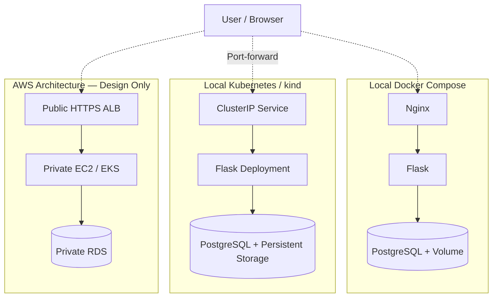

# OpsPulse — DevOps Integration Project

## Project Overview

OpsPulse is a lightweight incident tracking and
application health monitoring platform.

The goal is to integrate Linux, Git, Docker,
Docker Compose, Kubernetes, AWS architecture,
security, monitoring and troubleshooting.

This project is part of the DevOps Winter Arc
90-Day Challenge (Days 30–36).

## Technology Stack

| Component | Technology |
|---|---|
| Operating System | Debian 13 WSL2 |
| Application | Python Flask |
| Database | PostgreSQL |
| Reverse Proxy | Nginx |
| Version Control | Git and GitHub |
| Containerization | Docker |
| Multi-service Deployment | Docker Compose |
| Orchestration | Kubernetes (kind) |
| CI/CD | GitHub Actions (planned extension) |
| Cloud Architecture | AWS (design only) |

## Application Features

- Create and view incidents
- Update incident status
- Store incidents in PostgreSQL
- Application health endpoint: /health
- Database readiness endpoint: /ready
- Application logging
- Container health monitoring
- Scaling and rollback demonstrations
- Failure detection and recovery

These features are planned and will be implemented
progressively throughout the project.

## Architecture

Local development:

User -> Nginx -> Flask -> PostgreSQL

Deployment stages:

Linux -> Docker -> Docker Compose -> Kubernetes

AWS target design:

Internet -> Public ALB -> Private Application Tier
-> Private RDS PostgreSQL

The AWS architecture is conceptual and will not be
deployed without cost verification and approval.

See docs/architecture.md for further details.

## Seven-Day Roadmap

| Day | Focus |
|---|---|
| 30 | Project planning, Git and architecture |
| 31 | Linux, networking and application startup |
| 32 | Docker image, containers and security |
| 33 | Docker Compose and PostgreSQL integration |
| 34 | Kubernetes, health checks and rollback |
| 35 | AWS architecture, IAM and security |
| 36 | Final integration, troubleshooting and demo |

## Project Goals

1. Build a working application.
2. Deploy the same application across environments.
3. Understand networking and database communication.
4. Verify application health and logs.
5. Practise failure recovery.
6. Document the implementation and lessons learned.

## Security

- Never commit credentials or private keys.
- Use environment variables for configuration.
- Run containers as non-root where practical.
- Follow least-privilege access.
- Keep database ports private.
- Review Git changes before pushing.

## Current Status

Day 30 — Project setup and planning in progress.

## Documentation

- docs/architecture.md
- docs/revision-tracker.md

## Visual Architecture

The same OpsPulse application is deployed through
different stages. AWS is design-only.

