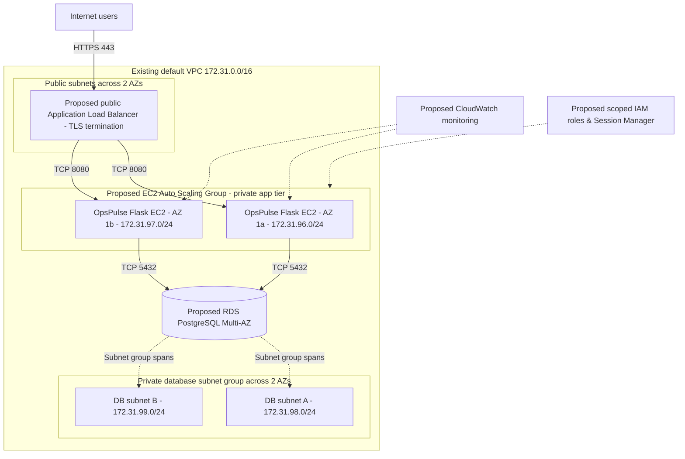

# DevOps Winter Arc — Day 35/90
## OpsPulse: AWS Architecture & Security Design Lab

> **Lab date:** 22 November 2026  
> **Project:** OpsPulse — Production Application Monitoring & Incident Tracker  
> **Project repository:** https://github.com/manasabitra1989/winter-arc-integration-project  
> **Working machine:** Debian2 (`~/winter-arc-integration-project`)  
> **AWS profile:** `devops-learner`  
> **AWS region:** `ap-south-1` (Mumbai)  
> **Git commit verified:** `7b39a0c` — `docs(day35): complete OpsPulse AWS architecture and security lab`  
> **Work type:** **Design-first AWS lab**, not an AWS application deployment.

---

## 1. Objective and the most important takeaway

The assignment was to translate the **same OpsPulse application built on Days 30–34** into a *proposed* secure, resilient, cost-conscious AWS architecture. Specifically: network boundaries, security-group rules, IAM least privilege, application/database traffic flow, health and recovery, observability, and an EC2-versus-EKS cost comparison.

**What we actually accomplished:** We reused the existing default VPC, configured four private subnets, one private route table and three restrictive security groups, reviewed our existing IAM learning identity, documented the proposed AWS application architecture, audited AWS resources, investigated an old manual RDS snapshot, and committed Day 35 design documentation to GitHub.

**What we did NOT do:** We did not deploy OpsPulse Flask, PostgreSQL, an ALB, EC2 application instances, an EC2 Auto Scaling Group, an EKS cluster, or an RDS instance into AWS. **No AWS application/failover tests were performed.** The application remained the same project previously run on local Linux, Docker Compose and a local Kubernetes kind cluster.

### Continuity from previous days

| Day | What happened | Where the app actually ran |
|---|---|---|
| 30 | OpsPulse integration planning and repository setup | Planning only |
| 31 | Flask API, `/health`, systemd, shell health scripts, cron, logrotate, deployment and rollback | Debian2/Linux |
| 32 | Packaged the Flask application in Docker | Local Docker |
| 33 | Docker Compose Flask + PostgreSQL, incident API, persistent named volume, database outage/recovery | Local Docker Compose |
| 34 | Flask Deployment, PostgreSQL StatefulSet and PVC, ConfigMap/Secret, Services, `/ready`, health probes and persistence checks | Local Kubernetes kind |
| **35** | AWS network/security configuration and **proposed** ALB + EC2 Auto Scaling + RDS Multi-AZ design | **Flask and PostgreSQL NOT deployed on AWS** |

**Memory aid:** Python **built** OpsPulse → Docker **packaged** it → Compose **connected** app and DB → Kubernetes **orchestrated** it → AWS Day 35 **designed its cloud home**.

---

## 2. Architecture — proposed versus existing

### 2.1 Proposed production design



**Important diagram reading:** The ALB, EC2 nodes, RDS, monitoring and IAM roles are **proposals**, not running resources. In particular, DB A/DB B are subnet locations, **not two independently created database instances**. An RDS Multi-AZ DB instance has AWS-managed primary/standby behavior; exact placement and failover are managed by AWS. The existing public subnets have the VPC Internet Gateway route. The **private** subnets do not have an internet default route.

### 2.2 Actual resources confirmed in AWS

| Resource | State during Day 35 | Notes |
|---|---|---|
| Default VPC | **Reused**, not created | `vpc-0db58479bcc738ebc`, CIDR `172.31.0.0/16` |
| Existing public subnets and Internet Gateway | **Reused / inspected** | Main route table supplies public internet route |
| Four private subnets | **Created and verified** | Two application, two database; across AZ 1a/1b |
| One private route table | **Created and verified** | Local VPC route only; associated with all four private subnets |
| Three OpsPulse Security Groups | **Created; inbound/outbound checked** | ALB, app, DB tiers |
| IAM user `devops-learner` | **Inspected**, not newly created | Managed and inline policies inventoried |
| ALB / EC2 / Auto Scaling / RDS / EKS / NAT | **Not deployed as part of Day 35** | Proposed diagram, not a working environment |
| Day 29 manual RDS snapshot | Found during audit; later **absent from listing** | See cleanup section; initial deletion attempt failed |

---

## 3. AWS environment setup

We used AWS CLI on **Debian2** rather than switching to the separate WSL Debian environment. AWS CLI was not installed at first. AWS CLI v2.42.1 was subsequently installed (exact installer command sequence is not preserved in this record). Authentication succeeded through the existing profile using remote login.

**Reference/verification commands** (do not paste login codes or secrets into documentation):

```bash
aws --version
aws login --remote --profile devops-learner --region ap-south-1
aws sts get-caller-identity --profile devops-learner
```

The `aws login` command is an authentication operation, **not** an infrastructure creation step. The IAM username, profile, region and VPC values here are project-specific. Do not publish account IDs, AWS credentials, sign-in codes or sensitive billing screenshots publicly; the GitHub README can omit specific account identifiers if the repository is public.

---

## 4. Existing VPC and public networking

**Default VPC:** `vpc-0db58479bcc738ebc` — `172.31.0.0/16`.

| Existing subnet | AZ | CIDR | Subnet ID |
|---|---|---|---|
| Public/default A | `ap-south-1a` | `172.31.32.0/20` | `subnet-00698086d711aa54c` |
| Public/default B | `ap-south-1b` | `172.31.0.0/20` | `subnet-0411976d508d370d9` |
| Public/default C | `ap-south-1c` | `172.31.16.0/20` | `subnet-06bd1d7967901109e` |

**Main route table:** `rtb-01d69df10874e9a68`.

| Destination | Target | Meaning |
|---|---|---|
| `172.31.0.0/16` | `local` | Traffic within VPC |
| `0.0.0.0/0` | `igw-00ceb7cd6b7fcadf5` | Route to existing Internet Gateway |

The default public subnets inherited this main route table and were observed with automatic public IP assignment enabled. **We did not create or manually place an actual ALB in them**; an ALB deployment would explicitly select subnets in at least two AZs.

Useful read-only inspection:

```bash
aws ec2 describe-vpcs --filters Name=isDefault,Values=true \
  --region ap-south-1 --profile devops-learner \
  --query 'Vpcs[].[VpcId,CidrBlock,IsDefault]' --output table

aws ec2 describe-route-tables \
  --route-table-ids rtb-01d69df10874e9a68 \
  --region ap-south-1 --profile devops-learner --output json
```

---

## 5. Four private subnets created

| Tier | Name | AZ | CIDR | Verified subnet ID |
|---|---|---|---|---|
| App A | `day35-opspulse-app-private-a` | `ap-south-1a` | `172.31.96.0/24` | `subnet-001cffb023e2efc81` |
| App B | `day35-opspulse-app-private-b` | `ap-south-1b` | `172.31.97.0/24` | `subnet-055cdbd6069309aea` |
| DB A | `day35-opspulse-db-private-a` | `ap-south-1a` | `172.31.98.0/24` | `subnet-0c9a19768bdfc303a` |
| DB B | `day35-opspulse-db-private-b` | `ap-south-1b` | `172.31.99.0/24` | `subnet-0552ecaa76cc21511` |

For **all four**: `MapPublicIpOnLaunch=False`, explicitly associated with Day 35 private route table, and verified in AWS CLI.

### Commands used — reproducible references, **not commands to rerun**

> **Do not rerun creation/association commands!** The named resources already exist. These are reconstructed reference commands matching verified resources and actions; they are **not claimed to be a verbatim history transcript**. Running `create-subnet` again would attempt to create a duplicate/overlapping CIDR. Tag creation details in the original live session may have differed.

```bash
# Illustrative create-subnet calls matching the observed resources.
aws ec2 create-subnet --vpc-id vpc-0db58479bcc738ebc \
  --availability-zone ap-south-1a --cidr-block 172.31.96.0/24 \
  --region ap-south-1 --profile devops-learner

aws ec2 create-subnet --vpc-id vpc-0db58479bcc738ebc \
  --availability-zone ap-south-1b --cidr-block 172.31.97.0/24 \
  --region ap-south-1 --profile devops-learner

aws ec2 create-subnet --vpc-id vpc-0db58479bcc738ebc \
  --availability-zone ap-south-1a --cidr-block 172.31.98.0/24 \
  --region ap-south-1 --profile devops-learner

aws ec2 create-subnet --vpc-id vpc-0db58479bcc738ebc \
  --availability-zone ap-south-1b --cidr-block 172.31.99.0/24 \
  --region ap-south-1 --profile devops-learner

# Set no automatic public IPs (operation was completed on all four).
for SUBNET in \
  subnet-001cffb023e2efc81 \
  subnet-055cdbd6069309aea \
  subnet-0c9a19768bdfc303a \
  subnet-0552ecaa76cc21511
do
  aws ec2 modify-subnet-attribute \
    --subnet-id "$SUBNET" --no-map-public-ip-on-launch \
    --region ap-south-1 --profile devops-learner
done
```

The loop above is a **compact reference** to operations already performed, not necessarily the exact syntax used interactively.

**Actual read-only verification command and actual result:**

```bash
aws ec2 describe-subnets \
  --subnet-ids \
    subnet-001cffb023e2efc81 \
    subnet-055cdbd6069309aea \
    subnet-0c9a19768bdfc303a \
    subnet-0552ecaa76cc21511 \
  --region ap-south-1 --profile devops-learner \
  --query 'Subnets[].[SubnetId,CidrBlock,AvailabilityZone,MapPublicIpOnLaunch]' \
  --output table
```

Output showed all four matching the table above and **`False`** for public IP auto-assignment. This setting alone does not guarantee isolation; the route table and Security Groups matter too.

---

## 6. Private route table and associations

**Name:** `day35-opspulse-private-rt`  
**Route table ID:** `rtb-00958f5db5fc68a04`  
**VPC:** existing default VPC.

Only route:

| Destination | Target |
|---|---|
| `172.31.0.0/16` | `local` |

**No** `0.0.0.0/0 → IGW` or `0.0.0.0/0 → NAT` route was added to the private table. The four private subnets were each **explicitly associated** with this table.

**Reference creation and associations — do not rerun:**

```bash
aws ec2 create-route-table \
  --vpc-id vpc-0db58479bcc738ebc \
  --region ap-south-1 --profile devops-learner

for SUBNET in \
  subnet-001cffb023e2efc81 \
  subnet-055cdbd6069309aea \
  subnet-0c9a19768bdfc303a \
  subnet-0552ecaa76cc21511
do
  aws ec2 associate-route-table \
    --route-table-id rtb-00958f5db5fc68a04 \
    --subnet-id "$SUBNET" \
    --region ap-south-1 --profile devops-learner
done
```

**Read-only verification:**

```bash
aws ec2 describe-route-tables \
  --route-table-ids rtb-00958f5db5fc68a04 \
  --region ap-south-1 --profile devops-learner \
  --query 'RouteTables[].{Routes:Routes,Associations:Associations}' \
  --output json
```

**Why this mattered:** Subnets inside the same VPC can use the local route, but a private workload without NAT, VPC endpoints, or another suitable path **cannot simply download packages, use external registries, or reach public AWS service endpoints**. The proposed application would need a connectivity plan before actual deployment.

---

## 7. Security Groups — created and verified

| Tier | Group name | Group ID |
|---|---|---|
| Public-facing ALB (proposed) | `day35-opspulse-alb-sg` | `sg-0e08f8b68789a4fac` |
| Private app (proposed) | `day35-opspulse-app-sg` | `sg-0a5f99b745a98ff82` |
| Private DB (proposed) | `day35-opspulse-db-sg` | `sg-015e80ebc7cff7210` |

### Actual verified rule matrix

| Group | Inbound | Outbound |
|---|---|---|
| ALB SG | **TCP 443** from `0.0.0.0/0` | **TCP 8080** to App SG |
| App SG | **TCP 8080** from ALB SG | **TCP 5432** to DB SG |
| DB SG | **TCP 5432** from App SG | **No outbound rules** |

The newly created groups' default allow-all outbound settings were removed/replaced. The ALB and application outbound restrictions are intentionally tight for this **learning design**; before production deployment, review DNS, SSM, CloudWatch, ECR/artifact download, package updates, TLS, agents, and other required egress. The DB group's absence of outbound rules does **not** block reply traffic for connections established under an inbound allow because Security Groups are **stateful**.

### Reference Security Group creation — **do not rerun**

```bash
aws ec2 create-security-group \
  --group-name day35-opspulse-alb-sg \
  --description 'OpsPulse ALB tier' \
  --vpc-id vpc-0db58479bcc738ebc \
  --region ap-south-1 --profile devops-learner

aws ec2 create-security-group \
  --group-name day35-opspulse-app-sg \
  --description 'OpsPulse app tier' \
  --vpc-id vpc-0db58479bcc738ebc \
  --region ap-south-1 --profile devops-learner

aws ec2 create-security-group \
  --group-name day35-opspulse-db-sg \
  --description 'OpsPulse database tier' \
  --vpc-id vpc-0db58479bcc738ebc \
  --region ap-south-1 --profile devops-learner
```

The descriptions above are examples; exact initial description strings were not retained. Actual Security Group identities and final rule content were verified.

### Reference ingress rules — **already configured; do not rerun**

```bash
# Internet -> ALB HTTPS
aws ec2 authorize-security-group-ingress \
  --group-id sg-0e08f8b68789a4fac \
  --protocol tcp --port 443 --cidr 0.0.0.0/0 \
  --region ap-south-1 --profile devops-learner

# ALB SG -> Flask App SG
aws ec2 authorize-security-group-ingress \
  --group-id sg-0a5f99b745a98ff82 \
  --protocol tcp --port 8080 \
  --source-group sg-0e08f8b68789a4fac \
  --region ap-south-1 --profile devops-learner

# App SG -> PostgreSQL DB SG
aws ec2 authorize-security-group-ingress \
  --group-id sg-015e80ebc7cff7210 \
  --protocol tcp --port 5432 \
  --source-group sg-0a5f99b745a98ff82 \
  --region ap-south-1 --profile devops-learner
```

### Outbound rule configuration — CLI templates

AWS Security Groups start with default outbound allow-all. The session verified that the three groups ended up with **ALB → App TCP 8080**, **App → DB TCP 5432**, and **DB → no outbound**. The exact original revoke command parameters/rule IDs from the earlier step-by-step session were not available as a verbatim transcript. The following **templates** show a method; they are **not to run against the already-configured groups**:

```bash
# Example syntax to revoke a default allow-all IPv4 outbound rule,
# ONLY after checking that exact rule exists in the target SG.
aws ec2 revoke-security-group-egress \
  --group-id <TARGET_GROUP_ID> \
  --ip-permissions '[{"IpProtocol":"-1","IpRanges":[{"CidrIp":"0.0.0.0/0"}]}]' \
  --region ap-south-1 --profile devops-learner

# Example syntax for a specific SG-reference outbound rule:
aws ec2 authorize-security-group-egress \
  --group-id <SOURCE_GROUP_ID> \
  --protocol tcp --port <PORT> \
  --source-group <DESTINATION_GROUP_ID> \
  --region ap-south-1 --profile devops-learner
```

For SGs with IPv6 outbound rules, inspect/revoke those separately as needed. Using a `--source-group` value in an egress rule identifies the destination SG in the AWS CLI command; AWS CLI naming can be confusing.

### Actual compact audit run

```bash
aws ec2 describe-security-groups \
  --region ap-south-1 --profile devops-learner \
  --group-ids \
    sg-0e08f8b68789a4fac \
    sg-0a5f99b745a98ff82 \
    sg-015e80ebc7cff7210 \
  --query 'SecurityGroups[].{Name:GroupName,InboundCount:length(IpPermissions),OutboundCount:length(IpPermissionsEgress)}' \
  --output table
```

**Actual observed counts:**

| SG | Inbound count | Outbound count |
|---|---:|---:|
| `day35-opspulse-alb-sg` | 1 | 1 |
| `day35-opspulse-app-sg` | 1 | 1 |
| `day35-opspulse-db-sg` | 1 | 0 |

Counts alone cannot establish ports/sources, but the rule contents were checked earlier in the lab. **No ALB, EC2 host or RDS instance was attached for real traffic testing.** Older Day 29 groups and default SG were deliberately left unchanged.

---

## 8. IAM — inspected existing learning permissions; designed application roles

**Existing user:** `devops-learner`. We did not create a new user or production application role for Day 35.

### Actual IAM CLI inventory commands and results

```bash
aws iam get-user \
  --profile devops-learner \
  --query 'User.[UserName,Arn,CreateDate]' --output table
```

Result: `devops-learner`; user creation timestamp `2026-11-09T12:29:17+00:00`. Full account ARN intentionally omitted here.

```bash
aws iam list-attached-user-policies \
  --user-name devops-learner --profile devops-learner \
  --query 'AttachedPolicies[].[PolicyName,PolicyArn]' --output table
```

**10 directly attached managed policies:**

1. `ReadOnlyAccess`
2. `AmazonVPCFullAccess`
3. `IAMUserChangePassword`
4. `SignInLocalDevelopmentAccess`
5. `Day26-RDS-Complete-Lab`
6. `Day29-AutoScaling-ServiceRole-Policy`
7. `Day26-EC2-Launch-Lab`
8. `Day29-AutoScaling-Policy`
9. `Day29-TargetGroup-Policy`
10. `Day29-LaunchTemplate-Policy`

```bash
aws iam list-groups-for-user \
  --user-name devops-learner --profile devops-learner \
  --query 'Groups[].[GroupName,Arn]' --output table
```

**Result:** no group memberships returned.

```bash
aws iam list-user-policies \
  --user-name devops-learner --profile devops-learner \
  --query 'PolicyNames' --output json
```

**7 inline policy names:**

1. `Day25-DeleteKeyPair`
2. `Day25-EC2-KeyPair-Access`
3. `Day25-EC2-Termination`
4. `Day26-EC2-Cleanup`
5. `Day26-RDS-SubnetGroup-Lab`
6. `Day26-SecurityGroup-Lab`
7. `Day26-Subnet-Lab`

We did **not** finish reviewing every custom policy document, the effective IAM permissions, organization SCPs, or a permissions boundary. An IAM boundary check was **proposed** but no verified output was provided. Counts of policies are not counts of permissions.

### Proposed least-privilege roles — documentation only

| Actor | Role design | Trust | Scoped capabilities |
|---|---|---|---|
| CI/CD pipeline | `OpsPulseDeploymentRole` | GitHub Actions OIDC restricted to this repo/branch/environment | Publish approved artifact, trigger approved deploy, inspect rollout; no general admin |
| Flask EC2 workload | `OpsPulseAppRole` with EC2 instance profile | EC2 service principal | Specific app secrets/parameters and designated logging/monitoring as required |
| Human operator | `OpsPulseOperatorRole` | Approved identity provider/Identity Center; MFA where applicable | Read health/logs, approved SSM access and limited recovery actions |

**Distinction:** IAM governs **AWS API identity actions**; Security Groups govern **network connections**. PostgreSQL credentials or optional IAM DB authentication are separate from SG reachability.

---

## 9. Resilience, health checks and deployment strategy — proposed

1. **Normal request:** User HTTPS 443 → public ALB → private Flask EC2 TCP 8080 → private PostgreSQL RDS TCP 5432.
2. **ALB health:** Proposed `/health` checks whether Flask answers. It does **not** prove PostgreSQL works.
3. **Readiness:** Existing OpsPulse `/ready` performs a database-aware check. A readiness failure can coexist with `/health` success; design health checks carefully so dependency failures do not cause unnecessary cascading loss of service.
4. **EC2 failure:** ALB can route to other healthy registered targets; a suitably configured EC2 Auto Scaling Group can replace failed instances. An ALB alone does **not** launch replacements.
5. **Availability Zone failure:** Surviving capacity in the second AZ can continue serving, subject to adequate capacity and healthy dependencies.
6. **Database failure:** Proposed RDS Multi-AZ can fail over to a standby. Clients must reconnect/retry; brief interruption is possible. A traditional Multi-AZ DB-instance standby does not provide read scaling.
7. **Deployment:** Build/test → version artifact → staging check → controlled rollout → monitor errors/target health → rollback to last known-good version if needed.
8. **Admin access:** Prefer AWS Systems Manager Session Manager with the required IAM roles, instance agent and private connectivity; do not open SSH 22 broadly.

All of these are **architecture explanations**, not verified AWS HA tests. The Day 31 local rollback and Day 34 Kubernetes readiness/persistence work are separate, previously completed practical tests.

---

## 10. Observability plan — proposed, not deployed

At least five monitoring signals were documented:

| Signal | Proposed source | Illustrative trigger | First response |
|---|---|---|---|
| ALB healthy targets | `HealthyHostCount` | Fewer than desired healthy targets for 2 minutes | Target health reason, EC2 health, SGs |
| ALB 5xx | ALB `HTTPCode_ELB_5XX_Count` | >5 in 5 minutes | Listener/target health, recent changes |
| Flask error rate | App logs / metric filter | >2% in 5 minutes | Inspect exceptions and dependencies |
| Latency | ALB target response time p95 | >1 s for 5 minutes | CPU, DB latency, request traces |
| EC2 CPU | CloudWatch `CPUUtilization` | >80% for 10 minutes | CPU-intensive work, scaling activities |
| EC2 memory | CloudWatch Agent metric | >85% for 10 minutes | Memory pressure and process inspection |
| RDS status/readiness | RDS events + `/ready` | Failover/unavailable or readiness errors | DB events, auth, DNS, connection checks |
| RDS connections | `DatabaseConnections` | Approaching configured capacity | Connection pooling/leaks |
| Deployment failures | CI/CD and rollout logs | Failed rollout | Stop/rollback, investigate logs |

Thresholds are initial **examples**, not production baselines. Log retention designs: example 14 days for verbose app logs and 30 days for system/deployment logs, subject to policy/cost. Never log credentials, tokens or sensitive content. CloudWatch dashboards and alarms were **not** created in AWS during Day 35.

---

## 11. Cost comparison — EC2 versus EKS

| Criterion | Option A — ALB + EC2 Auto Scaling + RDS | Option B — ALB + EKS + RDS |
|---|---|---|
| Complexity | Lower for this Flask app | Higher Kubernetes/network/add-on operations |
| Scaling | EC2 instance scaling | Pod + node scaling |
| Security | IAM, SGs, OS/instance management | IAM, RBAC, SGs, Pod security |
| Multi-AZ | ALB/instances across AZs | Kubernetes nodes/Pods across AZs |
| Database | Private RDS | Private RDS |
| Additional control-plane charge | No EKS cluster charge | EKS cluster pricing |
| Recommended for this learning design | **Yes**, simpler and cost-aware | Future alternative if managed Kubernetes is needed |

Possible charges: ALB hours and capacity units, EC2, EBS, RDS, snapshots/backups, EKS cluster and workers (if used), NAT Gateway, VPC endpoints depending on type, public IPv4 allocation, data transfer and CloudWatch. **No precise monthly prices were verified for a deployed topology.** Do not assume Free Tier without checking current eligibility. Use [AWS Pricing Calculator](https://calculator.aws/) with specific region, sizing and traffic assumptions for estimates.

---

## 12. Cost/resource audit — actual commands and evidence

The audit was conducted in **`ap-south-1`**, with profile `devops-learner`. An earlier read-only audit found no EC2, RDS instances, NAT gateways, ELBv2 load balancers, Elastic IPs, EBS volumes or owned EBS snapshots at that point. **Fresh final outputs for every one of these categories were not provided in this conversation. Do not label the entire account cost-clean.**

### Read-only audit commands (safe to rerun)

```bash
# EC2 instances in any non-terminated state / includes terminated if still listed
aws ec2 describe-instances --region ap-south-1 --profile devops-learner \
  --query 'Reservations[].Instances[].[InstanceId,State.Name,InstanceType]' --output table

# RDS DB instances
aws rds describe-db-instances --region ap-south-1 --profile devops-learner \
  --query 'DBInstances[].[DBInstanceIdentifier,DBInstanceStatus,DBInstanceClass]' --output table

# NAT Gateways
aws ec2 describe-nat-gateways --region ap-south-1 --profile devops-learner \
  --query 'NatGateways[].[NatGatewayId,State]' --output table

# Modern ELBv2 load balancers
aws elbv2 describe-load-balancers --region ap-south-1 --profile devops-learner \
  --query 'LoadBalancers[].[LoadBalancerName,Type,State.Code]' --output table

# Elastic IP allocations
aws ec2 describe-addresses --region ap-south-1 --profile devops-learner \
  --query 'Addresses[].[PublicIp,AllocationId]' --output table

# EBS volumes
aws ec2 describe-volumes --region ap-south-1 --profile devops-learner \
  --query 'Volumes[].[VolumeId,State,Size]' --output table

# Self-owned EBS snapshots
aws ec2 describe-snapshots --owner-ids self --region ap-south-1 \
  --profile devops-learner \
  --query 'Snapshots[].[SnapshotId,State]' --output table

# MANUAL RDS snapshots — this one was checked again and returned empty
aws rds describe-db-snapshots --snapshot-type manual \
  --region ap-south-1 --profile devops-learner \
  --query 'DBSnapshots[].[DBSnapshotIdentifier,Status]' --output table
```

These checks do not include everything AWS may charge for (for example, S3 objects, CloudWatch log storage, classic ELB, automated RDS backups, all other regions, public IPv4s used by resources other than Elastic IP allocations, and historical usage). Review billing/Cost Explorer separately with authorized access. Existing VPC networking configuration is not itself proof that no charges exist elsewhere.

### 12.1 Unexpected Day 29 snapshot found

The audit initially returned:

```text
Snapshot: day29-postgres-snapshot
Status: available
```

Inspection command actually run:

```bash
aws rds describe-db-snapshots \
  --db-snapshot-identifier day29-postgres-snapshot \
  --region ap-south-1 --profile devops-learner \
  --query 'DBSnapshots[].{Snapshot:DBSnapshotIdentifier,SourceDB:DBInstanceIdentifier,Created:SnapshotCreateTime,Engine:Engine,AllocatedGiB:AllocatedStorage,Status:Status}' \
  --output table
```

**Observed details:** Source DB `day29-postgres`, engine PostgreSQL, created `2026-11-15T10:48:06.770000+00:00`, allocated source storage 20 GiB, status `available`. **20 GiB was not a measured billable snapshot size.**

The user explicitly confirmed the backup was no longer required and authorized its deletion.

### 12.2 Initial deletion attempt failed (IAM AccessDenied)

The command **actually attempted**:

```bash
aws rds delete-db-snapshot \
  --db-snapshot-identifier day29-postgres-snapshot \
  --region ap-south-1 --profile devops-learner \
  --query 'DBSnapshot.[DBSnapshotIdentifier,Status]' \
  --output table
```

**Observed error:**

```text
AccessDenied when calling DeleteDBSnapshot:
... not authorized to perform rds:DeleteDBSnapshot ...
because no identity-based policy allows rds:DeleteDBSnapshot
```

**Lesson:** `ReadOnlyAccess` permits inspection but not deletion. A successful `describe-db-snapshots` does not prove permission for `delete-db-snapshot`.

### 12.3 Attempt to add IAM inline policy hit a quota

In the AWS IAM console, while trying to add a narrowly scoped deletion policy, the user saw:

```text
Your policy exceeds the non-whitespace character limit of 2048.
The character limit includes the total character count of all inline policies for devops-learner.
```

**Cause:** Seven existing inline policies already consumed much of the user's 2,048-character combined inline-document quota. The 10 directly attached managed policies have a separate attachment quota. **We did not verify or implement a successful IAM policy change through the CLI**. The advice was to avoid deleting existing lab permissions blindly; an authorized administrator could handle one-time cleanup without adding broader permissions.

### 12.4 Final manual snapshot verification succeeded

The same manual snapshot listing was repeated after the IAM-console discussion:

```bash
aws rds describe-db-snapshots \
  --snapshot-type manual \
  --region ap-south-1 --profile devops-learner \
  --query 'DBSnapshots[].[DBSnapshotIdentifier,Status]' --output table
```

**Actual observed result:** **Empty output.** The `day29-postgres-snapshot` no longer appeared and no manual RDS DB snapshots were returned in Mumbai at the time of verification.

**Evidence boundary:** The mechanism/identity that removed it was not observed in the transcript. Do **not** claim the denied CLI command succeeded or that the account's total AWS charges are zero. The local configuration and prior Day 29 resources were otherwise deliberately preserved.

---

## 13. Troubleshooting / lessons learned

| Issue encountered | How it was investigated or addressed | Lesson |
|---|---|---|
| AWS CLI absent on Debian2 | Installed CLI v2; authenticated with existing AWS login profile | Tools must be available on the actual working host |
| Trouble finding private route table in Console | Checked region, VPC filters, AWS CLI resource ID and associations | Console filters/region can hide resources from view |
| Private subnet design not obvious | Set `MapPublicIpOnLaunch=False`, explicitly associated local-only route table | Public-IP toggle **alone** does not make a subnet private |
| Default SG outbound allowed everything | Removed/restricted egress; verified individual rules and counts | Least privilege for network traffic |
| Long JSON/table output inconvenient | Used `--query`, `--output table`, concise result counts | CLI queries improve troubleshooting readability |
| RDS manual snapshot left behind from prior lab | Found and inspected specific snapshot | Backups may persist after database deletion and may incur charges |
| `rds:DeleteDBSnapshot` AccessDenied | Identified missing IAM action; did not falsely claim successful deletion | Permissions are action- and resource-specific |
| IAM inline policy 2048-character quota | Recognized combined inline policy limit; avoided indiscriminate policy removal | Quotas also matter in real operations |
| Day 35 diagram initially placed DB subnets inside Auto Scaling group | Corrected Mermaid so DB tier is separate | ASG manages EC2 instances, not RDS/database subnets |
| Confusion about progress from K8s to AWS | Distinguished **design/network setup** from **actual deployment** | Do not claim an application is deployed merely because VPC exists |

### Optional diagnostics when an actual cloud deployment exists

These commands are **examples only**; they were **not run against OpsPulse in AWS** because no app EC2/ALB/RDS resources existed:

```bash
# On an authorized Linux EC2 application host, check app listener and local health:
sudo ss -lntp | grep ':8080'
curl --max-time 5 -v http://127.0.0.1:8080/health

# Compare only-loopback binding vs all-local-interface binding:
# 127.0.0.1:8080 -> loopback only
# 0.0.0.0:8080 -> all local IPv4 interfaces (SG/routing still govern remote reachability)
```

---

## 14. Production troubleshooting practice completed — **simulations**

The user answered four hypothetical incidents correctly (**4/4**). These were interview exercises, **not events measured from AWS resources**.

| Question | Symptom | Correct investigation/fix | Key learning |
|---|---|---|---|
| 1 | ALB returns HTTP 503, EC2 running | Check target-group registration, health and failure reasons first | EC2 `running` ≠ app ready; ALB can also fail-open with all unhealthy targets, so inspect exact 503 source |
| 2 | Health passes on local loopback, ALB timeout | Flask bound to `127.0.0.1`; bind appropriate interface (lab `0.0.0.0`) and enforce network controls | Local-only vs remotely reachable listeners |
| 3 | Flask bound correctly but ALB timeout | Allow App SG inbound TCP 8080 **from ALB SG**, not broad `0.0.0.0/0` | SG references enforce approved network source |
| 4 | `/health` 200, `/ready` 503, DB connect timeout | Correct DB SG inbound TCP 5432 **from App SG** | Process health ≠ dependency readiness |

**Health endpoints:** `/health` reports application responsiveness; `/ready` additionally checks DB connectivity. RDS reporting `available` does not automatically prove the app can connect (SGs, DNS, credentials and database configuration can still block it). For a production Flask process, use a production WSGI server rather than Flask's development server.

---

## 15. Interview practice — five questions completed

Interview answers were evaluated as exercises; the scores reflect feedback in the conversation, **not an external certification or benchmark**.

| Question | Technical accuracy | Completeness |
|---|---:|---:|
| Why private application subnets? | 8/10 | 4/10 |
| Why ALB when two EC2 instances exist? | 9/10 | 4/10 |
| What if one AZ fails? | 9/10 | 3/10 |
| IAM vs Security Groups? | 7/10 | 4/10 |
| Local Kubernetes Day 34 vs AWS Day 35? | 9/10 | 2/10 |
| **Average** | **8.4/10** | **3.4/10** |

### Interview-ready answers

**Q1 — Private subnets:** "We proposed OpsPulse application instances in private subnets so they aren't directly exposed to the internet. Users would connect through an internet-facing ALB; the App Security Group accepts TCP 8080 only from the ALB Security Group."

**Q2 — ALB:** "An ALB distributes HTTP requests across healthy application targets and checks their health. If an instance fails and other targets are healthy, it can route requests to those targets. EC2 Auto Scaling, not ALB, handles configured replacement of instances."

**Q3 — AZ failure:** "With app instances across AZs, a surviving healthy target can continue to serve requests when another AZ fails. Auto Scaling can restore capacity and a correctly configured RDS Multi-AZ deployment can fail over the database, although interruptions are possible."

**Q4 — IAM versus Security Groups:** "IAM controls what AWS API operations an identity can perform. Security Groups are stateful network firewalls that allow only configured traffic to attached resources. Our snapshot deletion failure was an IAM problem; Flask-to-PostgreSQL port 5432 is a network Security Group concern."

**Q5 — Kubernetes versus AWS:** "On Day 34, we actually deployed Flask and PostgreSQL in a local kind Kubernetes cluster, including probes and persistent storage. On Day 35, we configured AWS networking/security and designed—but did not deploy—ALB, EC2 Auto Scaling and RDS. AWS and Kubernetes are not alternatives; Kubernetes can also run on AWS through EKS."

### How to answer with more confidence

Use a three-part structure: **what it is → why it matters → how OpsPulse used it (or would use it)**. Explicitly say **'implemented'** for verified resources and **'proposed/designed'** for services not deployed.

---

## 16. Documentation created and tracked in Git

Files created under `docs/day35/`:

1. `README.md` — comprehensive Day 35 record
2. `aws-architecture.md` — Mermaid design, VPC boundaries and architecture decisions
3. `security-group-matrix.md` — network traffic rules and restrictions
4. `iam-least-privilege.md` — proposed CI/CD, app and human roles
5. `resilience-and-traffic-flow.md` — ALB, ASG, RDS failover, rollback
6. `observability-plan.md` — five-plus signals, alerts, retention and first response
7. `cost-comparison.md` — EC2 Auto Scaling versus EKS costs and tradeoffs

The existing `docs/revision-tracker.md` was **updated**, without replacing the Days 30–34 entries.

### Documentation-related commands actually used

```bash
cd ~/winter-arc-integration-project
mkdir -p docs/day35

# The Markdown files were written with shell here-documents:
# cat > docs/day35/<filename>.md <<'EOF' ... EOF

ls -lh docs/day35/
grep -nE 'mermaid|flowchart|Internet Users|Auto Scaling|Multi-AZ' \
  docs/day35/aws-architecture.md

grep -nE 'Private Application Tier|Private Database Tier|RDS PostgreSQL|flowchart' \
  docs/day35/aws-architecture.md

git status --short
git diff --check
```

The Mermaid architecture diagram was corrected using a Python local-file modification that replaced the diagram block, retaining the other Markdown sections. The corrected `grep` output confirmed separate **Private Application Tier - EC2 Auto Scaling** and **Private Database Tier - RDS Multi-AZ** blocks.

### Git operations

Commands shared/used in the closing sequence:

```bash
cd ~/winter-arc-integration-project

git add docs/day35/ docs/revision-tracker.md

git diff --cached --stat
git diff --cached --check

git commit -m 'docs(day35): complete OpsPulse AWS architecture and security lab'
git push origin main

git status
git log -1 --oneline
```

**Actual final user-verified Git output:**

```text
On branch main
Your branch is up to date with 'origin/main'.

nothing to commit, working tree clean
7b39a0c (HEAD -> main, origin/main) docs(day35): complete OpsPulse AWS architecture and security lab
```

**Note about this expanded README:** This file was prepared **after** that verified commit to provide a fuller learning record. It is **not automatically part of `7b39a0c`**. If you replace the local `docs/day35/README.md` with this expanded version, it will require a **new Git commit and push**. Do not claim this expanded file is already on GitHub.

---

## 17. Final verified vs pending checklist

- [x] Reuse default VPC; no new VPC created
- [x] Four private subnets across two AZs created and verified
- [x] Automatic public IP allocation disabled on all four
- [x] Private route table associated with four subnets; local route only
- [x] Three OpsPulse Security Groups created; final rule matrix and counts verified
- [x] Existing IAM user/policy names and group membership inventoried
- [x] Proposed IAM roles, ALB/EC2/RDS design and recovery behavior documented
- [x] CloudWatch observability strategy and cost comparison documented
- [x] Old Day 29 manual RDS snapshot found, investigated and finally absent in read-only listing
- [x] Day 35 Git commit `7b39a0c` verified on `origin/main`; working tree clean at that time
- [x] Four simulated production troubleshooting questions answered
- [x] Five interview questions answered and evaluated
- [ ] Full fresh audit of all major billable categories with results recorded, plus other regions and billing account review
- [ ] Actually deploy OpsPulse to AWS (**not required for Day 35**) and test real app/database connectivity
- [ ] Actually test EC2/AZ/RDS failover (**not required for Day 35**)
- [ ] If adopting this expanded README, replace the repo copy and create a new commit

### Next project milestone

**Day 36 — OpsPulse Failure, Recovery & End-to-End Demonstration**, continuing the same local project. Start with a baseline status check of Debian2, Docker Compose, Kubernetes, existing OpsPulse endpoints and any relevant AWS cost-bearing resources before intentionally introducing failures. Do not change or delete the Day 35 default VPC, four private subnets, route table or Security Groups without a documented cleanup decision.

---

## 18. One-page memory sheet

```text
                    DAY 35: WHAT DID WE DO?

Day 31        Python Flask API RUNNING on Debian2
Day 32        Docker image / container PRACTICED
Day 33        Flask + PostgreSQL via Docker Compose RUNNING
Day 34        Flask + PostgreSQL on local kind K8s RUNNING
Day 35        AWS CLOUD NETWORK & SECURITY PREPARED
              ├── REUSED existing default VPC
              ├── CREATED 4 private subnets (2 AZs)
              ├── CREATED private route table (local only)
              ├── CREATED 3 restrictive Security Groups
              ├── REVIEWED existing IAM permissions
              ├── DESIGNED (not deployed) ALB + EC2 ASG + RDS
              ├── DOCUMENTED HA / monitoring / EKS comparison
              ├── VERIFIED Day 29 manual RDS snapshot absent
              └── COMMITTED design docs to GitHub: 7b39a0c

            AWS APPLICATION DEPLOYMENT?   NO.
            NEW BILLABLE APP STACK?       NO.
            REAL AWS FAILOVER TEST?       NO.

              Python -> Docker -> Kubernetes
                         |
                         v
              AWS Day 35 = designed its future cloud home
```

**Final lesson:** Creating a VPC subnet, route table, or Security Group is **infrastructure preparation**. Running a Flask/RDS workload behind a load balancer is **application deployment**. We did the former, not the latter.
