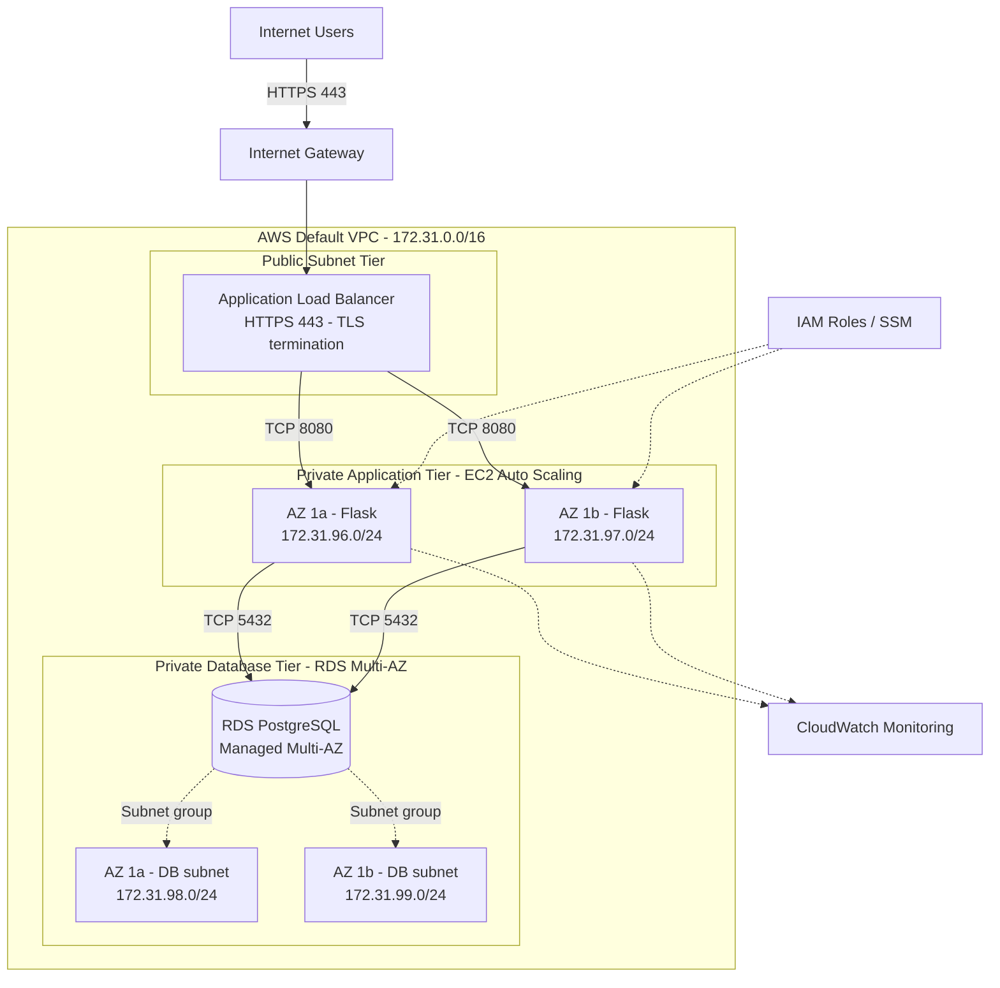

# Day 35 — OpsPulse AWS Architecture

## Design status

Proposed architecture only. Networking and security groups
exist, but ALB, EC2 Auto Scaling, and RDS are not deployed.

## Architecture diagram

## Existing network

VPC: vpc-0db58479bcc738ebc

Main route table:
rtb-01d69df10874e9a68
- VPC local route
- Default route to Internet Gateway

Private route table:
rtb-00958f5db5fc68a04
- 172.31.0.0/16 -> local
- No default internet route

### Private application subnets

AZ 1a: 172.31.96.0/24
AZ 1b: 172.31.97.0/24

### Private database subnets

AZ 1a: 172.31.98.0/24
AZ 1b: 172.31.99.0/24

## Security-group design

Internet -> ALB: TCP 443
ALB SG -> App SG: TCP 8080
App SG -> DB SG: TCP 5432
Database: no direct internet ingress

## Availability and recovery

- ALB distributes traffic across healthy application targets.
- EC2 Auto Scaling replaces unhealthy application instances.
- Two AZs reduce dependence on a single Availability Zone.
- RDS Multi-AZ provides database failover in the proposed design.
- Rolling deployments require health checks and rollback controls.

## Operations and monitoring

- ALB target health and HTTP 5xx
- OpsPulse application errors and latency
- EC2 CPU and memory monitoring
- RDS availability and connection metrics
- Deployment failures and rollback events
- CloudWatch alarms and defined log retention

## Private connectivity considerations

Current private subnets have local routing only.

Production application instances would need a planned
solution for AWS API access, image downloads, patching,
monitoring, and administration.

Possible choices include carefully scoped VPC endpoints
and NAT where necessary. Costs must be reviewed first.

The current App SG outbound rule allows only PostgreSQL
traffic, so additional approved rules would be required
before a real deployment.

## Cost and deployment scope

No ALB, EC2, RDS, NAT Gateway, or EKS resource was
deployed for this Day 35 architecture exercise.
